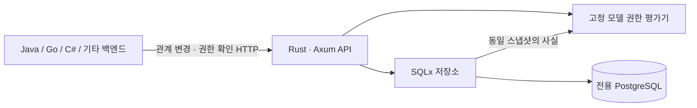

# Relation Guard

**Rust로 구현할 관계 기반 권한 서비스(ReBAC)의 설계 저장소.** 어떤 언어의 백엔드든 HTTP API로 관계를 등록·회수하고, 사용자의 리소스 접근 가능 여부를 확인한다.

> 상태: **설계 초안 v0.1 — 서비스 구현 전**. 아래 API, 성능 목표, 운영 절차는 구현 계약과 계획이며 동작하거나 달성했다고 주장하는 내용이 아니다. 현재 서버 실행 파일, Cargo 프로젝트, 컨테이너 이미지는 없다.

## 무엇을 만드는가

사용자 → 팀 소속 → 폴더 편집 권한 → 하위 문서 편집 권한을 계산한다. 원본 문서 내용과 로그인은 기존 애플리케이션이 관리한다. 엔진은 자신의 관계 데이터만 읽으며 고객 앱의 DB를 직접 조회하지 않는다.

## 첫 버전의 약속

- 테넌트 단위 격리. 사용자·팀·폴더·문서의 타입이 정해진 모델.
- 관계/객체를 원자적으로 등록·삭제하는 write API와 단건·일괄 check API.
- 직접 권한, 팀 권한, 부모 폴더 상속. `edit`는 `view`를 포함.
- 한 요청은 한 DB 스냅샷에서 판단. 커밋된 회수 이후 새 스냅샷은 변경을 반영.
- 재시도 가능한 쓰기, revision 충돌 감지, 변경 감사 기록, 제한된 판단 근거.
- 정확성·조직 격리·장애·성능을 재현할 테스트와 시나리오.

## 읽는 순서

1. [범위와 완료 기준](docs/01-scope.md)
2. [스택과 구조](docs/02-architecture.md)
3. [권한 규칙](docs/03-authorization-model.md)
4. [HTTP API 계약](docs/04-api.md)
5. [저장 구조와 조회 알고리즘](docs/05-storage.md)
6. [일관성과 연동 계약](docs/06-consistency.md)
7. [보안·배포·운영](docs/07-operations.md)
8. [검증과 성능 실험](docs/08-validation.md)
9. [단계별 구현 계획](docs/09-roadmap.md)
10. [설계 결정 기록](docs/10-decisions.md)
11. [근거 자료와 적용 범위](docs/11-references.md)

[설계용 DDL](spec/schema.sql), [요청·응답 예시](spec/examples/contracts.json), [권한 기대 결과](spec/examples/authorization-cases.json)도 포함한다. DDL은 구현 시 migration으로 옮기기 전 PostgreSQL 검증이 필요하다. 예시는 의도한 계약이며 서비스가 실행한 결과가 아니다.

## 개발 시작 시

[AGENTS.md](AGENTS.md)를 먼저 읽고 M0부터 순서대로 구현한다. 초기 전달 범위는 이 설계 문서까지다. 새로운 구현 요청 전 서버 개발을 시작하지 않는다.

현재 문서 검증: `python3 scripts/check_docs.py`. 외부 패키지를 설치하지 않고 내부 링크·JSON·SQL 주요 계약의 존재를 점검한다. DB/보안/서버 검증을 대신하지 않는다.

## 범위 밖

자체 로그인·문서 CRUD UI, 임의 정책 언어, OpenFGA/SpiceDB 호환, 명시적 deny, 중첩 팀, Redis, gRPC, 다중 리전, DB replica, Kubernetes 필수화는 v0.1에 포함하지 않는다. 운영 제품 대체나 보안 인증을 주장하지 않는다.

설계 기준일: 2026-10-01. 저장소는 초기 비공개이며 라이선스 부여는 보류한다.
