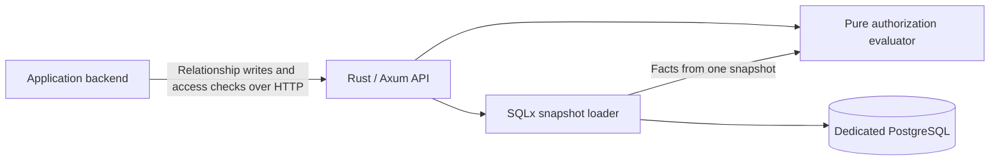

# Relation Guard

**A relationship-based authorization service in Rust.** Backends written in any language can use its HTTP API to register or revoke relationships and check access to resources.

> **Status: managed-authorization V1 implemented and verified.** Functional tests, native recovery, Docker deployment and the approved native performance gates passed. The service checks who may change permissions, not only who may access resources. See the [V1 verification report](verification/v1/report.md) for evidence, observed failures and environment limits.


**Latest reliability verification:** the 500ms pool-acquisition budget absorbs the tested short stall without replaying transactions. Functional/container CI and independent Linux native load gates passed; 99,006 normal-load requests had zero errors or drops. The local macOS rerun still failed during longer stalls, whose root cause remains unresolved. See the [before/after results and limits](verification/pool-burst/report.md). Earlier V1 measurements below retain their original source attribution.

## What it does



An application asks whether a user can view or edit a folder or document. Relation Guard evaluates direct grants, team membership, and inherited folder permissions. Applications continue to own login, business data, and enforcement of the returned decision. Authenticated backends assert the logged-in user with `X-Actor-Id`; the engine checks that user’s authority. Service keys must never be given to end users. The service reads its own relationship database, not the application's database.

## V1 scope

- A fixed `org-doc-v2` model: users, teams, folders, and documents within an isolated tenant.
- Atomic entity and relationship writes, with expected revisions and idempotent retries.
- Single checks and batch checks for up to 100 items belonging to one subject.
- Direct and team-based viewer/editor/manager grants; single-parent folder inheritance; manage implies edit and view.
- Organization administrators and members; protected administrator handover and last-administrator checks.
- User-authorized mutations checked against the pre-change state under the same transaction lock.
- Actor-bound retries and audit records, with a separate operator-only bootstrap/recovery path.
- Optional, scope-protected evidence for an allow decision; change audit records.
- Explicit error handling, bounded work, health checks, metrics, and container deployment files.

An explicit deny rule is not supported. Removing one grant does not revoke access provided by another grant. A failed evaluation returns an error, not a successful deny response, and callers must execute protected actions only after an explicit allow.

## Stack

| Component | Choice |
|---|---|
| Language | Stable Rust, edition 2024 |
| HTTP and async I/O | Axum and Tokio |
| Data access | SQLx and explicit SQL |
| Persistence | PostgreSQL 18; one primary, no decision cache |
| Serialization and observability | Serde, structured tracing, HTTP metrics |
| Testing | Rust tests, proptest, real PostgreSQL integration tests |
| Performance experiments | Criterion for the core; k6 for end-to-end HTTP |
| Deployment | Separate containers with Docker Compose |

Rust 1.96.1 and resolved dependency versions are pinned in rust-toolchain.toml and Cargo.lock. Rust is chosen for learning and safe systems implementation, not an unmeasured speed advantage over Java, Go, or C++.

## Try the implementation

Build with `cargo build --locked --workspace`. Provision the dedicated database and a tenant using `authz-admin`, then start `authz-server` with `DATABASE_URL` and `AUTHZ_KEYS_FILE`. Bootstrap the first organization administrator with `authz-admin bootstrap-admin TENANT_UUID USER_ID`. Every data request requires `X-Actor-Id`. See the [step-by-step guide](docs/13-running.md). The standard-library [Python client](examples/client.py) demonstrates grant, check, revoke, and fail-closed enforcement.

Run `PYTHON=.venv/bin/python scripts/verify.sh` with an isolated `TEST_DATABASE_URL` after installing `scripts/requirements-test.txt`. This runs the functional regression suite; recovery, deployment and performance use separate test harnesses.

## Validation

Run `scripts/verify.sh` for the complete functional regression suite: formatting, Clippy, contracts, core properties, real PostgreSQL transactions, management rules, 290 HTTP assertions, COMMIT faults, and the Python client. `scripts/test-stage.sh M4` adds native recovery and controlled connection stalls; M5 adds security review and load measurements. See the [test roadmap](docs/09-roadmap.md) for stage requirements.

Evidence is attributed to the source and environment actually tested:

- [Managed authorization V1](verification/v1/report.md): functional, recovery, deployment, and native performance results.
- [Pool reliability](verification/pool-burst/report.md): independent Linux normal-load gates passed with 99,006 correct requests and zero errors or drops. The local macOS rerun failed during longer stalls; the cause remains unresolved. Exploratory stress dropped work.
- [Verification history](verification/status.md): earlier results, including the failed v0.1 performance gate, are retained.

These measurements are not production throughput guarantees. A failed or skipped required check is not a pass. A refactor does not establish new performance measurements.

## Consistency boundaries

Each check or batch reads one PostgreSQL snapshot. A snapshot acquired after a successful revocation commit sees that change or a later state. An already-running check may still use an older snapshot. Returned revisions describe the observation; they are not access tokens.

The service does not atomically coordinate a permission check with a write to another application's database. It does not provide global external consistency or cancellation of in-flight business operations. See the [integration contract](docs/06-consistency.md).

## Documentation

The README is in English. Detailed design documents currently use Korean; API identifiers and examples use English.

1. [Scope and completion criteria](docs/01-scope.md)
2. [Stack and architecture](docs/02-architecture.md)
3. [Authorization semantics](docs/03-authorization-model.md)
4. [HTTP API contract](docs/04-api.md)
5. [Storage and query algorithms](docs/05-storage.md)
6. [Consistency and application integration](docs/06-consistency.md)
7. [Security, deployment, and operations](docs/07-operations.md)
8. [Validation and performance methodology](docs/08-validation.md)
9. [Stage-by-stage implementation and testing](docs/09-roadmap.md)
10. [Architecture decisions](docs/10-decisions.md)
11. [Primary references and their applicability](docs/11-references.md)
12. [Acceptance test matrix](docs/12-acceptance-tests.md)
13. [Running locally](docs/13-running.md)
14. [Native verification plan and environment limits](docs/14-native-verification.md)
15. [Managed authorization rules and migration](docs/15-managed-authorization.md)

Supporting artifacts: [design DDL](spec/schema.sql), [API examples](spec/examples/contracts.json), and [authorization cases](spec/examples/authorization-cases.json). The initial migration and constraints have been tested against PostgreSQL 18. Examples specify expected behavior; they are not recorded server responses.

## Working on this repository

Read [AGENTS.md](AGENTS.md) before changes. Follow the [running and testing guide](docs/13-running.md) for native binaries, local credentials, the Python client, and the Compose setup.

Run the current document checks from the repository root:

```sh
python3 scripts/check_docs.py
```

This checks local links, English README text, JSON examples, stage/test references, and basic specification invariants. It does not test a server, execute SQL, or verify security or performance.

## Out of scope

Login, a document-management UI, arbitrary policy languages, nested teams, explicit deny rules, Redis, gRPC, multi-region operation, read replicas, and mandatory Kubernetes deployment are excluded from V1. This is not an OpenFGA/SpiceDB-compatible implementation or a security-certified product.

Design baseline: 2026-10-01. The repository is private. An open-source license has not been selected.
