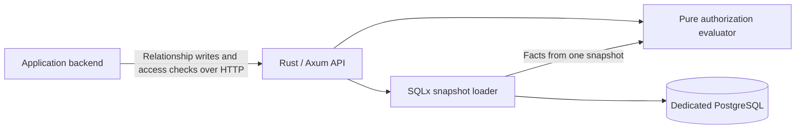

# Relation Guard

**A relationship-based authorization service in Rust.** Backends written in any language can use its HTTP API to register or revoke relationships and check access to resources.

> **Status: functional implementation verified; one native performance gate remains unmet.** Core, transactions, HTTP, recovery and key rotation pass locally and in clean Linux CI. All planned native load profiles ran, but one batch repetition exceeded the failure-rate target. Container deployment remains unverified. See [verification status](verification/status.md).

## What it does



An application asks whether a user can view or edit a folder or document. Relation Guard evaluates direct grants, team membership, and inherited folder permissions. Applications continue to own login, business data, and enforcement of the returned decision. The service reads its own relationship database, not the application's database.

## v0.1 scope

- A fixed `org-doc-v1` model: users, teams, folders, and documents within an isolated tenant.
- Atomic entity and relationship writes, with expected revisions and idempotent retries.
- Single checks and batch checks for up to 100 items belonging to one subject.
- Direct and team-based grants, single-parent folder inheritance, and `edit` implying `view`.
- Optional, scope-protected evidence for an allow decision; change audit records.
- Explicit error handling, bounded work, health checks, metrics, and container deployment files.

An explicit deny rule is not supported. Removing one grant does not revoke access provided by another grant. A failed evaluation returns an error, not a successful deny response, and callers must execute protected actions only after an explicit allow.

## Stack

| Component | Choice |
|---|---|
| Language | Stable Rust, edition 2024 |
| HTTP and async I/O | Axum and Tokio |
| Data access | SQLx and explicit SQL |
| Persistence | PostgreSQL 18; one primary, no decision cache |
| Serialization and observability | Serde, structured tracing, HTTP metrics |
| Testing | Rust tests, proptest, real PostgreSQL integration tests |
| Performance experiments | Criterion for the core; k6 for end-to-end HTTP |
| Deployment | Separate containers with Docker Compose |

Rust 1.96.1 and resolved dependency versions are pinned in rust-toolchain.toml and Cargo.lock. Rust is chosen for learning and safe systems implementation, not an unmeasured speed advantage over Java, Go, or C++.

## Try the implementation

Build with `cargo build --locked --workspace`. Provision the dedicated database and a tenant using `authz-admin`, then start `authz-server` with `DATABASE_URL` and `AUTHZ_KEYS_FILE`. See the [step-by-step guide](docs/13-running.md). The standard-library [Python client](examples/client.py) demonstrates grant, check, revoke, and fail-closed enforcement.

Run `PYTHON=.venv/bin/python scripts/verify.sh` with an isolated `TEST_DATABASE_URL` after installing `scripts/requirements-test.txt`. This runs the implemented regression suite; it does not certify the unfinished release gates.

## Stage gates

M0–M3 functional verification and M4-native recovery checks pass. M5-native measurement is complete, but its acceptance gate did not pass: batch repetition 3 returned six HTTP 503 responses out of 3,001 requests (0.20%, against a <0.1% target). No wrong authorization decision was observed. Container deployment verification is deferred under the [approved native testing plan](docs/14-native-verification.md). Detailed test cases, required evidence, and pass/fail rules are defined in the [implementation roadmap](docs/09-roadmap.md) and [acceptance test matrix](docs/12-acceptance-tests.md).

| Stage | Deliverable | Required validation |
|---|---|---|
| M0 | Workspace, typed contracts, migrations | Build/lint, valid and invalid API fixtures, real PostgreSQL constraints |
| M1 | Pure authorization evaluator | Rule fixtures, independent reference comparison, property tests, proof and limit boundaries |
| M2 | Storage and transactional writes | Rollback, revision conflicts, retry safety, snapshot reads, deterministic concurrency schedules |
| M3 | HTTP API and service authentication | HTTP contracts, tenant/scope isolation, error mapping, deadlines, overload and disconnect tests |
| M4 | Deployable integration | Clean Docker bootstrap, external-language client, restart persistence, key rotation, backup/restore |
| M5 | Release evidence | Full regression, reproducible load tests, fault recovery, dependency and secret review |

A stage passes only when its required cases pass and evidence is recorded for the tested commit. A skipped or unavailable required test is not a pass. Implementation and testing of later stages must not hide an unresolved earlier gate.

## Measured local results

Release build on macOS arm64 with a local PostgreSQL 18.6 endpoint; no CPU/memory caps. Each profile used a 60-second warmup and three 300-second measurements.

| Workload | Successful-response latency across runs | Errors and acceptance |
|---|---|---|
| 100 single checks/s | p95 6.08–6.41 ms; p99 17.99–21.84 ms | 90,002/90,002 correct responses; all three runs passed |
| 10 batches/s, 100 checks each | p95 29.16–30.46 ms | Six 503 responses in run 3; failure-rate gate missed |

The one-million-relationship dataset, mixed writes, stress and recovery profiles also ran. Stress results include dropped load-generator iterations. See the [complete report](verification/M5-report.md), including preserved failures, internal costs and environment limits. These are engineering measurements, not production SLA guarantees. The [connection-pool investigation](verification/pool-timeout-investigation.md) records a controlled reproduction, service-pool hardening and separate diagnostic replays; the original failed acceptance result is preserved.

## Consistency boundaries

Each check or batch reads one PostgreSQL snapshot. A snapshot acquired after a successful revocation commit sees that change or a later state. An already-running check may still use an older snapshot. Returned revisions describe the observation; they are not access tokens.

The service does not atomically coordinate a permission check with a write to another application's database. It does not provide global external consistency or cancellation of in-flight business operations. See the [integration contract](docs/06-consistency.md).

## Documentation

The README is in English. Detailed design documents currently use Korean; API identifiers and examples use English.

1. [Scope and completion criteria](docs/01-scope.md)
2. [Stack and architecture](docs/02-architecture.md)
3. [Authorization semantics](docs/03-authorization-model.md)
4. [HTTP API contract](docs/04-api.md)
5. [Storage and query algorithms](docs/05-storage.md)
6. [Consistency and application integration](docs/06-consistency.md)
7. [Security, deployment, and operations](docs/07-operations.md)
8. [Validation and performance methodology](docs/08-validation.md)
9. [Stage-by-stage implementation and testing](docs/09-roadmap.md)
10. [Architecture decisions](docs/10-decisions.md)
11. [Primary references and their applicability](docs/11-references.md)
12. [Acceptance test matrix](docs/12-acceptance-tests.md)
13. [Running locally](docs/13-running.md)
14. [Native verification plan and environment limits](docs/14-native-verification.md)

Supporting artifacts: [design DDL](spec/schema.sql), [API examples](spec/examples/contracts.json), and [authorization cases](spec/examples/authorization-cases.json). The initial migration and constraints have been tested against PostgreSQL 18. Examples specify expected behavior; they are not recorded server responses.

## Working on this repository

Read [AGENTS.md](AGENTS.md) before changes. Follow the [running and testing guide](docs/13-running.md) for native binaries, local credentials, the Python client, and the draft Compose setup.

Run the current document checks from the repository root:

```sh
python3 scripts/check_docs.py
```

This checks local links, English README text, JSON examples, stage/test references, and basic specification invariants. It does not test a server, execute SQL, or verify security or performance.

## Out of scope

Login, a document-management UI, arbitrary policy languages, nested teams, explicit deny rules, Redis, gRPC, multi-region operation, read replicas, and mandatory Kubernetes deployment are excluded from v0.1. This is not an OpenFGA/SpiceDB-compatible implementation or a security-certified product.

Design baseline: 2026-10-01. The repository is private. An open-source license has not been selected.
